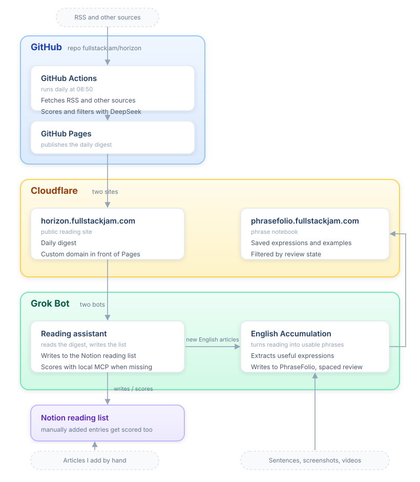

+++
title = "Building a Personal Reading System"
date = 2026-11-16
draft = false
description = "Fetch and score once at 08:50, keep the list in Notion, then turn the English I read into expressions I can use. A reading pipeline where each layer does one job."
tags = ["reading", "automation", "Horizon", "Notion", "AI"]
+++

I built myself a daily reading system on top of the open-source project Horizon. The problem it solves is simple: good articles are scattered everywhere and attention is limited. I want to see, each day, the few pieces worth reading carefully — and worth rereading later — and then add them to my own list.

<!--more-->

Every day at around 08:50 (Asia/Shanghai), GitHub Actions runs Horizon once: it pulls articles from RSS and other sources, scores and filters them with DeepSeek, generates that day's digest, and publishes it to GitHub Pages. The public site horizon.fullstackjam.com sits behind Cloudflare, and the repository is [fullstackjam/horizon](https://github.com/fullstackjam/horizon). This is the only time collection runs.

Grok Bot runs two bots: a reading assistant and English Accumulation. Once the digest is generated, the reading assistant reads it and adds those articles to my Notion reading list, reusing the scores Horizon has already produced rather than rescoring everything. The list in Notion doesn't come only from this digest — I add articles by hand too. Those entries usually have no score, so around 10:00 the assistant uses a local Horizon MCP to fill in only the empty Score fields.

Newly added English-language articles go to English Accumulation. It pulls out expressions worth learning, writes them to [PhraseFolio](https://phrasefolio.fullstackjam.com), my phrase notebook, and uses spaced repetition to help me put them to use. Sentences I come across myself — in videos, blogs, or chats — can be sent to it directly.

The whole chain has four layers: GitHub Actions handles the daily collection and digest, Cloudflare hosts the horizon and PhraseFolio sites, Grok Bot runs the reading assistant and English Accumulation, and Notion stores my reading list.

For me, the key is that each layer does one job: Horizon finds and filters, Notion keeps things for the long term, and English Accumulation turns the English I've read into expressions I can actually use. Collection never runs twice, and no article in the same digest gets scored twice.
