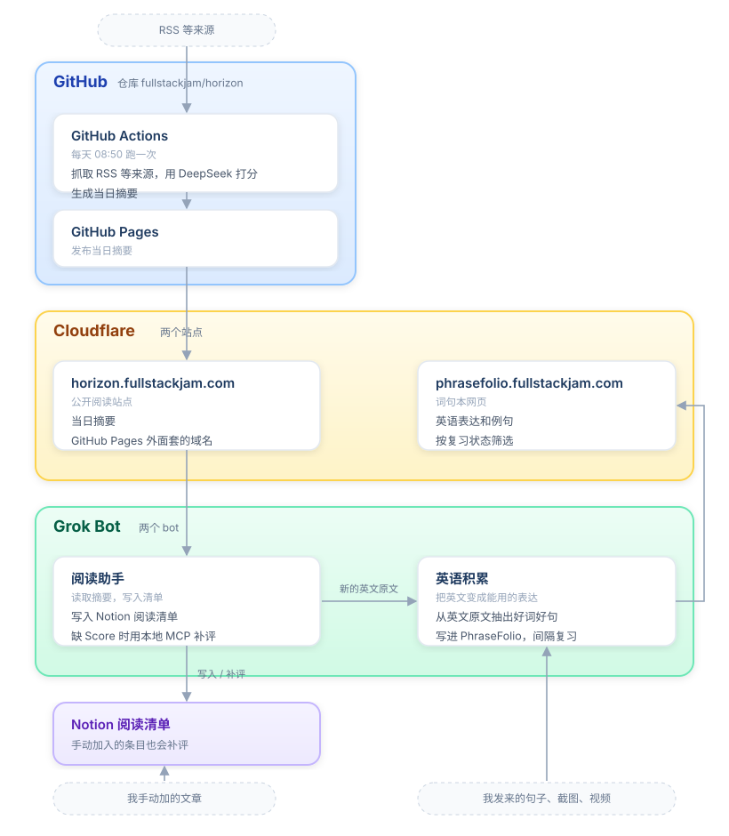

+++
title = "打造一套属于自己的个人阅读系统"
date = 2026-11-16
draft = false
description = "早上八点五十自动抓取和打分，Notion 长期保存，再把读过的英文变成能用的表达。一条各管一段的个人阅读链路。"
tags = ["阅读", "自动化", "Horizon", "Notion", "AI"]
+++

我用开源项目 Horizon，给自己搭了一套日常阅读系统。它要解决的问题很简单：好文章散落在各处，注意力有限，希望每天先看到少数值得认真读、也值得以后重读的内容，再把它们收进自己的清单里。

<!--more-->

每天大约早上 08:50（Asia/Shanghai），GitHub Actions 会跑一次 Horizon：从 RSS 等来源抓取文章，用 DeepSeek 打分、筛选，生成当日摘要，发布到 GitHub Pages。horizon.fullstackjam.com 这个公开站点外面套了一层 Cloudflare，仓库在 [fullstackjam/horizon](https://github.com/fullstackjam/horizon)。采集只发生这一次。

Grok Bot 上跑着两个 bot：阅读助手和「英语积累」。摘要生成后，阅读助手会读取这份摘要，写入我的 Notion 阅读清单，分数直接复用 Horizon 已经打好的结果，不会再全部重打。Notion 里的清单并不只来自这份摘要，我也会手动加文章。这类条目通常没有分数，阅读助手大约会在 10:00 用本地的 Horizon MCP，只给空着的 Score 补评。

新写入清单的英文原文，会交给「英语积累」。它从文章里抽出值得学的表达，写进 [PhraseFolio](https://phrasefolio.fullstackjam.com) 这个词句本网页，再用间隔复习帮我把这些表达用出来。我自己在视频、博客或聊天里遇到的好句子，也可以直接发给它。

整套链路可以看成四层：GitHub Actions 负责每天采集和生成摘要，Cloudflare 托管 horizon 和 PhraseFolio 两个站点，Grok Bot 上跑着阅读助手和「英语积累」两个 bot，Notion 存放我的阅读清单。

对我来说，这条链路的关键是各管一段：Horizon 负责发现和筛选，Notion 负责长期保存，英语积累负责把读过的英文变成能用的表达。采集不会跑两遍，同一篇摘要里的文章，也不会再被打一遍分。
